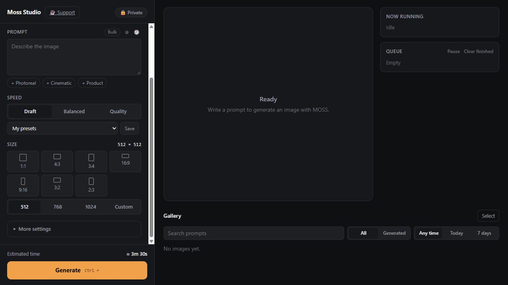

# MOSS Image Studio

**MOSS Image Studio** is a local text-to-image app for Windows PCs with NVIDIA RTX graphics. Generate images from prompts in a browser-based studio using the official [MOSS-Image](https://github.com/OpenMOSS/MOSS-Image) models and [WeeLLM](https://github.com/Jit-Roy/WeeLLM) weight streaming for GPUs with limited VRAM.



[](https://github.com/sanketshinde3001/moss-image-studio)

## Quick start on Windows

You need Windows, Python 3.13, Git, an NVIDIA GPU with a current driver, and enough SSD space for the selected model. The MOSS-Image-SFT download is about 27 GB. Model weights are downloaded separately and are not included in this repository.

Open PowerShell in the project folder and run:

```powershell
./setup.ps1
./download.ps1
./studio.ps1
```

Then open [http://127.0.0.1:7860](http://127.0.0.1:7860). To download the Base model too, run `./download.ps1 -Model Base` and select it in the studio. Downloads can resume if interrupted. For a slower or unstable connection, use `./.venv/Scripts/python.exe download.py SFT --workers 8 --parallel-files 2`.

## What it does

- Generates images from text with MOSS-Image-SFT or MOSS-Image-Base.
- Provides prompts, negative prompts, seeds, variations, styles, and aspect ratios.
- Manages a serial generation queue with pause, reorder, cancel, and progress controls.
- Includes a local gallery with search, compare, favorites, saved presets, and ZIP downloads.
- Offers a private mode that stores temporary results only when you choose to keep them.
- Runs its web server on localhost; it is not exposed to your network by default.

MOSS Image Studio currently supports **text-to-image generation**. Image editing and inpainting are not available in this app.

## NVIDIA RTX 3050 with 4 GB VRAM

The built-in Draft preset starts at 512 px and 12 steps. Balanced uses 768 px and 30 steps; Quality uses 1024 px and 50 steps. Output is capped at 1024 pixels per side. A draft uses fewer steps to shorten a trial and can produce different quality from a longer run.

This project completed one measured portrait generation on an **RTX 3050 Laptop GPU with 4 GB VRAM** at **768 × 1024 pixels and 30 steps**. It took **15 minutes 39 seconds**, including model loading. System-wide peak GPU memory sampled during the run was **1,823 MiB (about 1.78 GiB)**. This is one run on one laptop; generation time varies with model loading, available RAM, SSD, driver, other GPU activity, and laptop cooling. It is not a speed guarantee. No landscape or product generation was measured.

The default streaming budget is 2.5 GB VRAM, with a 2 GB RAM cache budget, disk-backed weights, and 256 px VAE tiles. Actual process RAM can exceed the cache budget. An SSD is recommended. You can adjust the budgets before launch:

```powershell
$env:MOSS_VRAM_GB = '2.5'
$env:MOSS_RAM_GB = '2'
./studio.ps1
```

More VRAM does not guarantee faster generation. The streaming approach trades speed for lower memory use. Close GPU-heavy apps and allow the laptop to cool between long runs.

## Frequently asked questions

### What is MOSS Image Studio?
It is a local Windows app for generating images from text prompts with the MOSS-Image models on NVIDIA CUDA GPUs. It uses WeeLLM to stream model weights for low-VRAM systems.

### Can MOSS Image Studio run on an RTX 3050 with 4 GB VRAM?
One 768 × 1024 image was successfully generated on an RTX 3050 Laptop GPU with 4 GB VRAM. That run took 15 minutes 39 seconds including model loading and reached a sampled system-wide peak of 1,823 MiB. Results and heat vary by laptop and workload.

### Does it support image editing or image-to-image?
No. The current app supports text-to-image generation only.

### How much storage does the MOSS model need?
The MOSS-Image-SFT download is about 27 GB. Leave additional SSD space for the Python environment, caches, and generated images. The Base model is a separate download.

### Where do the models come from?
The app downloads official MOSS-Image model files from OpenMOSS/Hugging Face. Review the [MOSS project](https://github.com/OpenMOSS/MOSS-Image) and the [MOSS-Image-SFT model card](https://huggingface.co/OpenMOSS-Team/MOSS-Image-SFT) for model details and licensing.

## Troubleshooting

- **CUDA is unavailable:** check `nvidia-smi`, update the NVIDIA driver if needed, then rerun `./setup.ps1`.
- **A model is missing:** run `./download.ps1` for the model selected in the studio.
- **Out of memory:** close GPU-heavy apps, reduce image size or the `MOSS_VRAM_GB` budget, and run one queued job at a time.
- **Model loading is slow:** use an SSD and allow time for streamed weights to load.
- **Imports fail:** rerun setup. WeeLLM and its Diffusers/Transformers dependencies need compatible versions.

## Credits and licenses

MOSS Image Studio code is distributed under the MIT License in this repository. MOSS model weights have separate terms; see the official [MOSS project](https://github.com/OpenMOSS/MOSS-Image) and [model card](https://huggingface.co/OpenMOSS-Team/MOSS-Image). WeeLLM is a separate project; see its [repository](https://github.com/Jit-Roy/WeeLLM).

